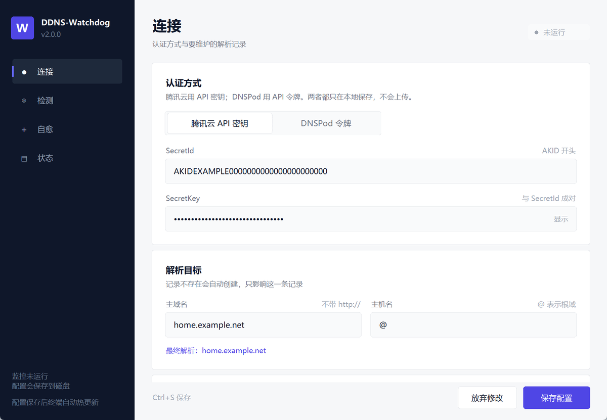
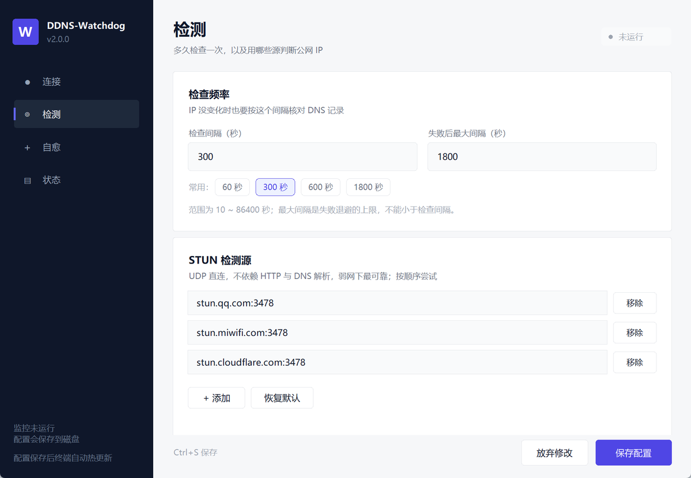
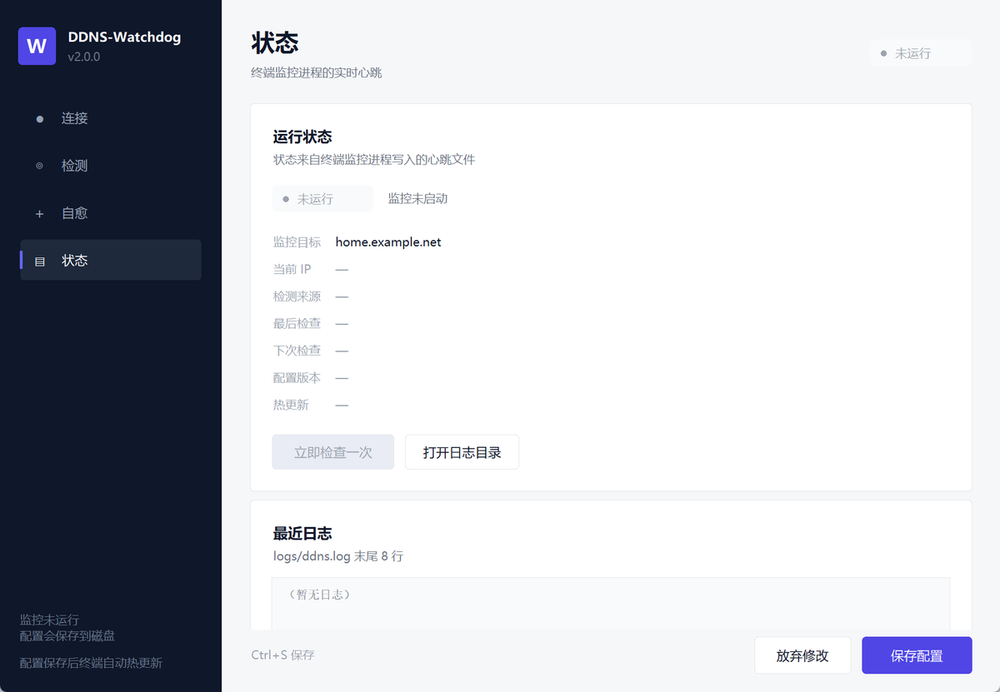

# DDNS-Watchdog

Windows 上的 DDNS 客户端，支持腾讯云 DNSPod。公网 IP 变了就改解析；检测接口全挂、甚至网卡假死时，它会自己换源、退避，并尝试把网络拉回来。

v2 起拆成**两个独立启动器**：终端负责跑监控，图形界面负责改配置。两者可以同时开着，图形界面点保存后终端会自动热更新，不用重启。



## 相比 ddns-go 的改进

| 常见问题 | DDNS-Watchdog 的做法 |
|---|---|
| HTTP 检测接口超时后一直失败 | 先用 STUN（UDP）直接取公网 IP，不走 HTTP 和 DNS；再备 7 个 HTTP 源，失败自动换源并降权 |
| 网络抖动时不停重试、刷屏 | 指数退避，失败后逐步拉长间隔，最长 30 分钟 |
| 网卡假死，只能拔插网线 | 全部检测源失败达到阈值后自动 `flushdns`，再执行 `ipconfig /release /renew` |
| DNS 记录被改成别的地址 | 定期核对云端记录，发现漂移自动改回 |
| 检测源被污染，写错 IP | 换 IP 时最多采样 3 个源做多数确认；私网/保留段直接丢弃 |

## 两个启动器

| 启动器 | 做什么 | 不做什么 |
|---|---|---|
| `launcher_console.py` | 跑 DDNS 监控循环、写日志、网络自愈 | 不画界面 |
| `launcher_gui.py` | 编辑配置、校验、写 `config.json`、查看运行状态 | 不跑监控、不碰 DNS |

**同时运行时的约定**

- 图形界面只写配置文件，从不直接操作 DNS
- 终端在每轮等待里以 0.15 秒为粒度检查配置文件指纹，发现变化就重新校验并应用
- 校验不通过时保留旧配置继续运行，同时在终端日志里逐条打印字段级原因；图形界面下次刷新也能看到「热更新失败」
- 配置写入走「临时文件 + `os.replace`」，终端不会读到写了一半的 JSON
- 同一时间只允许一个监控进程（全局互斥体），避免两个实例互相覆盖记录

| 检测页 | 状态页 |
|---|---|
|  |  |

## 快速开始

### 直接运行源码

需要 Python 3.8 及以上，无第三方依赖。

```powershell
python launcher_gui.py        # 打开图形配置，填好并保存
python launcher_console.py    # 启动监控
```

### 使用打包好的 exe

从 [Releases](https://github.com/Mark136880/DDNS-Watchdog/releases) 下载：

- `DDNS-Watchdog-Gui.exe`：图形配置
- `DDNS-Watchdog-Console.exe`：终端监控

放到同一个目录下（配置、状态、日志都读写 exe 所在目录），先开图形界面配置，再启动终端监控。**建议右键以管理员身份运行终端监控**，自愈里的 `ipconfig /renew` 才有权限。

## 配置

| 字段 | 默认 | 说明 |
|---|---|---|
| `provider` | `tencent` | `tencent` 用 SecretId/SecretKey；`dnspod` 用 `ID,Token` |
| `domain` | — | 主域名，如 `example.com` |
| `sub_domain` | `@` | 主机名，`@` 表示根域名 |
| `check_interval_seconds` | `300` | 正常时每 5 分钟检查一次（10~86400） |
| `max_interval_seconds` | `1800` | 失败退避的最大间隔，不能小于检查间隔 |
| `heal_after_failures` | `1` | 连续多少轮全部检测源失败后触发自愈 |
| `auto_renew_adapter` | `true` | 自愈时是否 release/renew，会短暂断网几秒 |
| `stun_servers` | 腾讯 / 小米 / Cloudflare | UDP 3478，基本不受本机 DNS 故障影响 |
| `http_sources` | 7 个 | HTTP 备用检测源，按历史成功率动态排序 |
| `revision` | 自动 | 每次保存 +1，终端用它确认拿到了新配置 |

配置读写出 [`ddns_core/config.py`](ddns_core/config.py) 负责：先校验再落盘，非法值不会被写入。

## 运行中操作

终端监控里按 `Q`（`S` 同样有效）暂停并进入菜单：

```text
[1] 配置向导（改密钥 / 域名）
[2] 修改检查间隔
[3] 立即执行一次检查
[4] 重新加载配置文件
[5] 显示运行状态
[0] 退出程序
```

命令行参数：

```powershell
python launcher_console.py --setup     # 强制进入配置向导
python launcher_console.py --check     # 只检查一次就退出
python launcher_console.py --version
python launcher_gui.py --version
```

## 热更新是怎么生效的

```text
图形界面保存
  └─ 校验 → revision+1 → 原子写入 config.json
        └─ 终端在等待间隙发现文件指纹变化
              ├─ 校验通过 → 重建检测源、更新间隔/阈值/目标，立刻按新配置跑一轮
              └─ 校验失败 → 打印字段级原因，继续用旧配置，心跳里记录失败原因
```

几个细节：

- 换了域名或主机名，终端会清掉 `state.json` 里缓存的 IP，强制下一轮写入新目标
- 只改间隔不会打断正在进行的检查，下一轮生效
- 图形界面保存后如果终端没在运行，会提示「下次启动生效」

## 异常与提示

程序把失败分成「配置问题」和「运行问题」两类，分别给出可操作的提示：

| 场景 | 表现 |
|---|---|
| 配置字段非法 | 图形界面标红对应输入框 + 顶部横幅 + 自动切到出错的页面；终端打印 `字段：原因（建议）` |
| `config.json` 不是合法 JSON | 报出错误的行号列号；终端继续用旧配置，图形界面提供「原文件备份为 `config.invalid.json`」 |
| 没有写权限 | 提示换到可写目录或用管理员身份运行 |
| 配置文件被占用 | 写锁 5 秒超时后提示稍后重试 |
| 认证失败 | 打印腾讯云/DNSPod 的具体错误码，并给出排查步骤 |
| 所有检测源失败 | 记录失败轮数，达到阈值触发自愈，随后指数退避 |
| 已有监控在运行 | 第二个实例直接退出并提示，不会抢记录 |

## 开机自启

以管理员打开 PowerShell，把路径换成实际位置：

```powershell
schtasks /Create /TN "DDNS-Watchdog" /TR "D:\DDNS\DDNS-Watchdog-Console.exe" /SC ONSTART /RU SYSTEM /RL HIGHEST /F
```

任务计划环境建议同时设置环境变量 `DDNS_WATCHDOG_NOPAUSE=1`，避免出错退出时卡在「按回车」。

取消自启：

```powershell
schtasks /Delete /TN "DDNS-Watchdog" /F
```

## 环境变量

| 变量 | 作用 |
|---|---|
| `DDNS_WATCHDOG_DRYRUN=1` | 走完整检测流程但不修改 DNS。在另一台机器上试用时务必打开，避免和正在运行的实例互相改同一条记录 |
| `DDNS_WATCHDOG_NOPAUSE=1` | 出错退出时不等待回车 |

## 自己打包

```powershell
pip install pyinstaller

pyinstaller --onefile --console --clean --noconfirm `
    --name DDNS-Watchdog-Console launcher_console.py

pyinstaller --onefile --windowed --clean --noconfirm `
    --name DDNS-Watchdog-Gui launcher_gui.py
```

产物在 `dist\`。

## 目录结构

```text
ddns_core/          核心：配置、检测、API、自愈、监控循环、运行时心跳
ui/                 图形界面：主题、自绘控件、四个页面、主窗口
launcher_console.py 终端启动器
launcher_gui.py     图形配置启动器
ddns_client.py      v1 兼容入口（自动转调终端启动器）
tests/              离线测试与界面冒烟脚本
docs/               界面截图
```

## 测试

```powershell
python -m unittest tests.test_config   # 24 项：校验、原子写、热更新
python tests/smoke_gui.py              # 构建界面并渲染一帧后自动关闭
python tests/smoke_save.py             # 保存链路（写入临时目录）
```

这些测试都不联网，也不会修改真实 DNS 记录。

## 注意

- 同一条解析记录只应该有一个监控实例；第二个实例会被互斥体挡住
- `auto_renew_adapter` 为 `true` 时，检测源全失败会主动断开并重连网卡
- 不要把填好密钥的 `config.json` 提交到仓库或发给别人

## 许可

[MIT](LICENSE)
